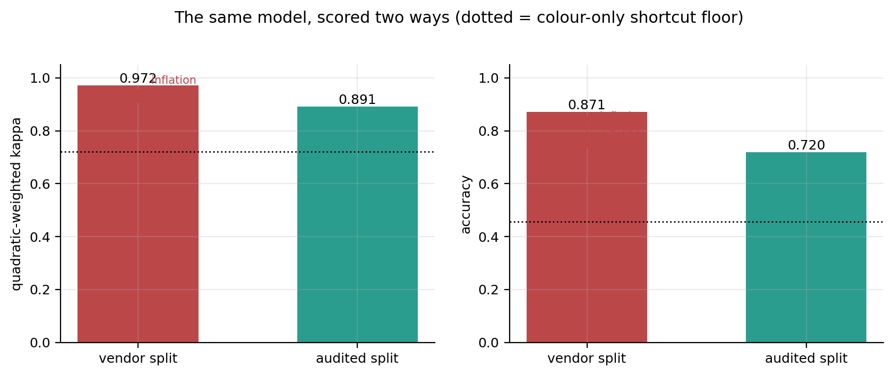

# Audit Before Accuracy: Explainable Ordinal Deep Learning for Androgenetic Alopecia Severity Grading

**Mahibi Islam**
Department of Computer Science and Engineering, BRAC University, Dhaka, Bangladesh

📄 [Paper (PDF)](paper/AGA_ordinal_paper.pdf) · 📓 [Notebook](notebooks/AGA_Ordinal_Grading.ipynb) · 🔒 [Locked split manifest](data/splits/split_manifest.csv) · 🗂 [Model card](docs/MODEL_CARD.md)

> **Status.** Course project (CSE 463, BRAC University), **not peer-reviewed**. The audit and the
> locked split are fully reproducible (see [Reproducing](#reproducing)). The CORN-vs-softmax
> comparison comes from a single seed over three CV folds with no paired significance test. Treat
> it as exploratory evidence, not an established result.
>
> **Research prototype.** Not a diagnostic device, makes no treatment recommendation, and is not a
> substitute for clinical judgement.

---

## Summary

Androgenetic alopecia (AGA) is staged on the seven-point **Norwood–Hamilton** scale. The scale is
*ordinal*, and even experts agree only moderately on it (ICC 0.63–0.68). Most deep-learning work
treats staging as flat classification and reports accuracy on public benchmarks whose integrity
nobody has checked.

This project does two things:

1. **Audits the public `hair_norwood_hamilton` benchmark (Roboflow Universe, CC BY 4.0) and shows
   that it cannot be used as published.** Its 5,783 files come from only **1,447 independent
   photographs**. **53.2 %** of its test split has a perceptual near-duplicate in train. Two
   non-clinical artefacts are strongly confounded with the label. A logistic regression on
   **28 colour statistics alone** reaches **QWK 0.72** on the vendor split.
2. **Compares softmax, CORAL and CORN heads on a shared ResNet-50 trunk** under a leakage-corrected,
   group-disjoint protocol with a SHA-256-locked test set, and measures how much the unaudited
   split inflates results.

## Key results

**Audit of the published benchmark**

| Property | Value |
|---|---|
| Published image files | 5,783 |
| Independent groups (pHash ∪ source id) | **1,447** |
| Byte-identical duplicates | 0 |
| Vendor test images with a near-duplicate in train | 132 / 248 (**53.2 %**) |
| Augmentation × stage, Cramér's V | 0.390 |
| Source collection × stage, Cramér's V | 0.432 |
| Class imbalance, file level → group level | 7.2 : 1 → **37.9 : 1** |

**Cross-validated benchmark, audited protocol** (pooled out-of-fold, 3 folds)

| Model | QWK | MAE | macro-F1 | bal. acc | acc | ±1 |
|---|---|---|---|---|---|---|
| Colour-only LR | 0.368 | 1.230 | 0.249 | 0.317 | 0.421 | 0.714 |
| Ordinal SVM (frozen RN50) | 0.760 | 0.412 | 0.273 | 0.273 | 0.675 | 0.932 |
| ResNet-50 + CE (softmax) | 0.869 | 0.340 | 0.520 | 0.531 | 0.714 | 0.960 |
| ResNet-50 + CORAL | 0.884 | 0.342 | 0.524 | 0.545 | 0.697 | 0.967 |
| **ResNet-50 + CORN** | **0.900** | **0.283** | **0.580** | **0.590** | **0.747** | **0.975** |

**Locked test set** (n = 289, evaluated once, ResNet-50 + CORN):
QWK **0.891** [0.832, 0.927] · MAE 0.311 · macro-F1 0.641 · **97.6 %** of predictions within one stage ·
unweighted κ 0.565 · ECE(±1) 0.019.

**Leakage ablation.** The same model, recipe and seed were trained under both protocols:

| Metric | Vendor split | Audited split | Inflation |
|---|---|---|---|
| QWK | 0.972 | 0.891 | +0.081 |
| Accuracy | 0.871 | 0.720 | **+0.151** |
| Macro-F1 | 0.893 | 0.641 | **+0.253** |



The paper also covers CORAL's posterior "valley" failure (48.3 % of its predictions; ECE 0.300),
calibration, robustness to residual similarity, and Grad-CAM analysis. Every number above comes from
the full run in [`results/`](results/): [`results_summary.json`](results/results_summary.json),
[`benchmark_cv.csv`](results/benchmark_cv.csv), [`test_predictions.csv`](results/test_predictions.csv)
and all [figures](results/figures/).

### Notes on the numbers

- **The colour-only floor depends on the library version.** The reported run (Colab,
  scikit-learn 1.6.1) gives QWK **0.722** on the vendor split. Re-running the same code with
  scikit-learn 1.8 gives **0.715** (accuracy 0.448 vs 0.456), because the logistic-regression solver
  converges slightly differently. The conclusion is unchanged either way. Every other audit number
  reproduces exactly.
- **There are two "audited colour floors".** QWK **0.444** is 5-fold CV over all 1,441 images
  (§2.11, Table VII). QWK **0.368** is the colour-only baseline inside the 3-fold development-set
  benchmark (Table II). Each is the right comparison within its own table.

## Repository layout

```
├── paper/AGA_ordinal_paper.pdf         the paper
├── notebooks/AGA_Ordinal_Grading.ipynb end-to-end pipeline: audit → splits → models → evaluation
├── scripts/verify_audit.py             CPU-only reproduction of the audit + locked split
├── data/
│   ├── README.md                       how to obtain the dataset
│   ├── raw/                            Roboflow export (not tracked; download it)
│   └── splits/
│       ├── split_manifest.csv          locked dev / test split (SHA-256 below)
│       └── audit_manifest.csv          all 5,783 files with source id, augmentation, group, label
├── results/                            outputs of the reported full run (metrics, predictions, figures)
├── docs/MODEL_CARD.md
├── requirements.txt
└── CITATION.cff
```

## Reproducing

### 1. Get the data

Download **`hair_norwood_hamilton` v1** in *Multi-Class Classification* (CSV) format from
[Roboflow Universe](https://universe.roboflow.com/onuralpszr/hair_norwood_hamilton/dataset/1) and
unzip it into `data/raw/`, so that `data/raw/train/_classes.csv` exists. See
[data/README.md](data/README.md).

### 2. Verify the audit and the locked split (CPU, ~1 min)

```bash
pip install numpy pandas scipy scikit-learn pillow
python scripts/verify_audit.py
```

This runs notebook sections 2–4 unchanged. It re-derives every audit number and rebuilds the
split manifest, then checks it against the published lock:

```
dc94878c954130dc3aa7140dae1043de7f5660f27d41f910b7ec846a3f51e193
```

### 3. Full pipeline (GPU)

Open [`notebooks/AGA_Ordinal_Grading.ipynb`](notebooks/AGA_Ordinal_Grading.ipynb) in Google Colab
(T4 or better) or run it locally from `notebooks/`.

* **Set `CFG.QUICK_RUN = False`.** The default `True` is a ~10-minute smoke test that is not
  reportable.
* The data cell finds `../data/raw` automatically. On Colab, use the Drive/upload/Roboflow routes
  in §1.
* The full run (3-fold benchmark of 4 deep models + 5 baselines, final model, Grad-CAM, leakage
  ablation) takes a few hours on a T4. Outputs go to `/content/outputs` on Colab and to
  `results/` locally.

The reported run used seed 1337, TensorFlow 2.20 and scikit-learn 1.6.1 on a Colab T4. A rerun
replaces the files in `results/`.

## Citation

```bibtex
@misc{islam2026auditbeforeaccuracy,
  title  = {Audit Before Accuracy: Explainable Ordinal Deep Learning for Androgenetic Alopecia
            Severity Grading on a Leakage-Corrected Benchmark},
  author = {Islam, Mahibi},
  year   = {2026},
  note   = {BRAC University, Department of Computer Science and Engineering}
}
```

## License

* **Code** (notebook, scripts): MIT, see [LICENSE](LICENSE).
* **Dataset**: `hair_norwood_hamilton` by Roboflow user *onuralpszr*,
  [CC BY 4.0](https://creativecommons.org/licenses/by/4.0/). The images are not redistributed here.
  The manifests in `data/splits/` contain filenames and derived labels only.
